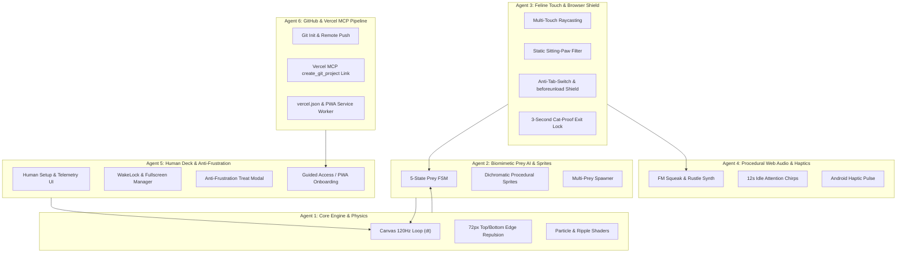

# PawPlay: Multi-Agent Engineering Implementation Plan

> [!IMPORTANT]
> **Mandatory Documentation Directive:**
> Every agent working on this codebase MUST record all implemented upgrades, architectural decisions, bug fixes, and empirical findings in `PROJECT_PLAN.md` and `IMPLEMENTATION_PLAN.md`. Never ship code without updating project documentation.

---

## 1. Executive Summary & Scientific Rationale

**PawPlay** is a zero-install, standalone Progressive Web Application (PWA) built for domestic cats to play on tablets and smartphones. Unlike existing native apps plagued by 100MB+ downloads, pop-up ads that cats accidentally tap, and colors calibrated for human vision rather than feline biology, PawPlay is engineered around **empirical feline physiology, capacitive hardware physics, modern browser standards, and tab-defense security**.

### Core Engineering Pillars & The "Why" Behind Every Feature

| Feature Domain | Technical Implementation | Biological / Physical / OS Reason ("The Why") |
| :--- | :--- | :--- |
| **Feline Dichromatic Palette** | High-contrast **Blue (`#0077FF`)**, **Yellow (`#FFD600`)**, and **Ultraviolet-adjacent Cyan/Violet** sprites on customizable high-contrast backgrounds (`#F5F3EF` warm parchment or `#12131A` deep night). | Cats are dichromats with cone photoreceptors peaking at ~450nm (blue) and ~550nm (green/yellow). They lack red cones; standard red laser dots appear dull grey/brown to cats. |
| **High-Refresh Frame Pacing (`deltaTime`)** | Uncapped `requestAnimationFrame` loop normalized by `performance.now()` delta-time ($dt$), targeting **120Hz (ProMotion / OLED)** displays. | Human flicker fusion frequency (FFF) is ~50–60Hz, whereas feline FFF is **70–100Hz**. A 60Hz animation without sub-pixel interpolation looks choppy to a cat. |
| **Anti-Tab-Switch & Anti-Deletion Shield** | 1. `beforeunload` unload interceptor.<br>2. PWA standalone mode (strips browser tabs completely).<br>3. `overscroll-behavior: none` (stops pull-to-refresh).<br>4. Expanded **72px top repulsion** away from tab bar.<br>5. `visibilitychange` auto-pause & mute. | In ordinary browsers, a cat swatting near the top edge can tap another tab, close the tab (`✕`), or pull down to refresh. A multi-layer defense prevents accidental closures and auto-pauses gracefully if minimized. |
| **Edge-Safe Guard Zone (OS Gesture Defense)** | Prey pathfinding strictly repels sprites from a **48px–72px perimeter dead-zone** along all screen edges, especially top tabs and bottom home bars. | Web apps cannot disable OS-level edge gestures (iOS Home Indicator swipe-up, Notification Center pull-down, Android Back swipe). Keeping prey away from edges prevents cats from accidentally exiting the browser. |
| **Capacitive "Toe-Bean" Hitbox & Multi-Touch** | Simultaneous `pointerdown`, `pointermove`, `touchstart`, and `touchmove` tracking with a **+45px radial hitbox expansion** and palm/body rejection logic. | Cat claws are non-conductive keratin (Mohs ~2.5) and register zero touch. Only the conductive fleshy paw pad ("toe bean") registers. Cats swipe laterally rather than tapping perpendicularly, requiring continuous drag intersection. |
| **Static Sitting-Paw Filter** | Track `touch.identifier`. Stationary touches (`< 12px` over `400ms`) are flagged as resting contact and suppressed from false hits. | A cat resting one paw or its chest on the tablet edge creates static contact points that must not block active swatting with the other paw. |
| **Biomimetic Prey AI State Machine** | 5-state Markov-style FSM: `STALK_CREEP`, `DART_SPRINT`, `FREEZE_TREMOR`, `EDGE_SKITTER`, and `CAUGHT_RESPAWN`. | Predictable linear bouncing (`vx *= -1`) bores cats within 15 seconds. Real prey exhibits erratic stop-and-go motion, sudden freezes with micro-tremors, and wall-hugging (thigmotaxis). |
| **Zero-Asset Procedural Web Audio Synthesizer** | Pure Web Audio API synthesis: FM-modulated rodent squeaks (3800Hz–5500Hz), filtered white-noise insect buzzes/rustles, and resonant low-pass water bloops. | Cats hear up to **64kHz** (humans ~20kHz) and orient toward high-frequency ultrasonic/near-ultrasonic rustling and squeaking. Procedural synthesis eliminates network latency and external audio assets. |
| **Anti-Frustration Session Timer & "Claw-Down" Mode** | Configurable session timer (default 10 mins) that gradually slows prey and ends with a **"Reward Your Cat Now" chime** for the owner. | Veterinary behavior science shows that endless chasing without a physical catch ("incomplete predatory sequence") causes neurotic frustration. Alerting the human to toss a physical treat or toy completes the hunt cycle. |
| **"Pounce-Cam" Reaction Captures** | Front-facing camera (`getUserMedia`) captures high-speed snapshots of the cat's face on catches and/or near-misses. Stored in IndexedDB with a human review gallery. | Cat owners love capturing their pet's intense "game face"; provides rewarding visual proof and social shareability without interrupting play. |
| **Deep Customization Suite** | User controls for prey count (1–4), speed (Kitten, Hunter, Apex, Ludicrous), size (Tiny, Normal, Chonky), haptic pulses, and sound volumes. | Accommodates kittens with slow reflexes, seniors with poor vision, and multi-cat households needing multiple simultaneous targets. |
| **High-Fidelity Sprite Pipeline** | Generated high-resolution transparent PNG/SVG sprites (via `image-generator` subagent) with directional rotation, animated wings, fins, and tails. | Crude geometric shapes fail to trigger feline predatory interest; photorealistic/stylized top-down biological sprites maximize prey drive. |
| **Automated GitHub & Vercel Deployment** | Push code to GitHub, link via Vercel MCP (`create_git_project`), with `vercel.json` headers targeting **`playpaw.vercel.app`**. | Enables instantaneous zero-cost HTTPS hosting with global edge delivery, ensuring required SSL for Wake Lock and PWA standalone capabilities. |

---

## 2. Multi-Agent Workstream Allocation (For Gemini 3.8 Flash High Team)



---

## 3. Detailed Workstream Specifications

### Workstream 1: Core Canvas Engine, 120Hz Delta-Time Loop & Edge-Safe Physics
**Assigned to:** `Agent-1 (Engine & Physics)`
**Target Files:** `src/engine.js` (or `Engine` namespace in `index.html`)

1. **High-DPI & High-Refresh Canvas Scaling:**
   * Scale canvas internal resolution by `Math.min(window.devicePixelRatio || 1, 2)`.
   * Normalize all velocity and acceleration vectors by `dt = Math.min((now - lastTime) / 1000, 0.05)`.
2. **Anti-Tab & OS Gesture Safe-Zone Repulsion Field:**
   * Define `SAFE_MARGIN_TOP = 72` (extra clearance from browser tab bar and address bar), `SAFE_MARGIN_BOTTOM = 72` (clearance from iOS Home Indicator), `SAFE_MARGIN_SIDES = 48` (CSS pixels).
   * Apply smooth inward steering acceleration whenever prey approaches margins. Hard clamp so prey never crosses the safe line.
3. **Visual Feedback System:**
   * Concentric shockwave ring + 18 burst particles in `#FFD600` (yellow) and `#00E5FF` (cyan) on pounce.
   * Background Themes: `Daylight Floor` (`#F4F1EA`), `Night Stalker` (`#10121A`), and `Koi Pond` (`#0A2239` with touch water ripples).

---

### Workstream 2: Biomimetic Prey AI & Feline-Calibrated Procedural Sprites
**Assigned to:** `Agent-2 (Prey AI & Procedural Graphics)`
**Target Files:** `src/prey.js`

1. **The 5-State Predatory FSM (`PreyAgent` Class):**
   * `FREEZE_TREMOR`: Stops for `0.6s–2.2s` with micro-jitter (`Math.sin(t * 45) * 1.5px`) and twitching antennae/tail.
   * `DART_SPRINT`: High-acceleration curved burst ($600\text{–}950\text{ px/s}$) for `0.4s–0.9s`.
   * `STALK_CREEP`: Sinusoidal creeping movement ($120\text{–}220\text{ px/s}$).
   * `EDGE_SKITTER`: Hugs the boundary of the `SAFE_MARGIN` perimeter before darting across the center.
   * `CAUGHT_RESPAWN`: 180ms squish effect, `0.7s` off-screen delay, enters from a safe margin.
2. **Feline-Visible Procedural Sprites (Zero External Assets):**
   * ** Dichromatic Laser / Firefly (`laser`):** Core `#FFFFFF`, halo `#FFD600` (yellow), outer glow `#0066FF` (blue), 8-point motion blur ribbon.
   * ** Scurrying Beetle / Roach (`bug`):** Espresso carapace (`#1A110B`), yellow/cyan highlights, 6 animated cycling legs, twitching antennae.
   * ** Field Mouse (`mouse`):** Grey-blue body (`#4A5568`), cream/yellow ears, whiskers, 4-node whipping tail.
   * ** Pond Koi (`fish`):** Golden-yellow (`#FFB703`) & cobalt-blue (`#219EBC`) 3-segment spinal kinematics with animated fins.
3. **Multi-Prey Scaling:** Default 1 on phones (`<768px`), selectable 1 to 3 on tablets.

---

### Workstream 3: Feline Capacitive Touch Engine & Browser Tab Defense Shield
**Assigned to:** `Agent-3 (Input & Browser Security)`
**Target Files:** `src/input.js`

1. **Accidental Tab-Switch & Tab-Deletion Defense:**
   * **`beforeunload` Interception:**
     ```javascript
     window.addEventListener('beforeunload', (e) => {
       if (isPlaying) {
         e.preventDefault();
         e.returnValue = ''; // Standard browser exit confirmation dialog
       }
     });
     ```
   * **`overscroll-behavior: none`:** Block pull-to-refresh and elastic bounce on mobile Safari/Chrome to prevent revealing toolbars or reloading tabs.
   * **`visibilitychange` Auto-Pause:**
     ```javascript
     document.addEventListener('visibilitychange', () => {
       if (document.visibilityState === 'hidden') {
         pauseGame();
         if (audioCtx) audioCtx.suspend();
       } else if (document.visibilityState === 'visible') {
         showPauseResumeOverlay();
       }
     });
     ```
2. **Continuous Swipe & Scratch Raycasting:**
   * Listen to `pointerdown`, `pointermove`, `touchstart`, and `touchmove` with `{ passive: false }`.
   * Test line-segment intersection between `(prevX, prevY)` and `(currX, currY)` against active prey circle (`radius + 42px` pad tolerance).
3. **Static Sitting-Paw Filter:**
   * Track `pointerId`. If movement `< 12px` over `400ms`, mark `isResting = true` to suppress continuous false ripples/hits while other paws remain fully active.
4. **Cat-Proof 8-Second Annulus Exit Lock:**
   * Corner widget: A very hidden, ultra-faint icon showing an `✕` inside a circle (`opacity: ~0.15`, blending into background to avoid attracting feline pounces).
   * **Clockwise Filling Annulus (Circle with a Hole):**
     * When pressed and held, it reveals a faint donut ring (circle with a hole) that gradually fills with an active stroke **clockwise over exactly 8 seconds**.
     * If the finger releases or an accidental cat paw swipe touches it for `< 8 seconds`, the progress immediately cancels, resets to 0%, and fades back out.
     * Completing the full 8-second hold immediately ends the game session and transitions to the treat screen/human menu.

---

### Workstream 4: Procedural Web Audio Synthesizer & Acoustic Lures
**Assigned to:** `Agent-4 (Audio & Haptics)`
**Target Files:** `src/audio.js`

1. **Singleton Web Audio Context:** Unlocked on human start gesture, with auto-resume checks on touch/visibility.
2. **Procedural Generators:**
   * `playMouseSqueak()`: Dual-oscillator FM sweeping `4800Hz -> 2600Hz -> 3900Hz` over `110ms` with `45Hz` vibrato.
   * `playBugSound()`: Bandpass-filtered white noise burst (`5200Hz`, `Q = 3.5`) with `25ms` percussive pulses.
   * `playWaterSplash()`: Low-pass sweep (`1200Hz -> 280Hz`) + droplet sine bend (`600Hz -> 1400Hz`).
3. **12s Idle Acoustic Lure:** If no touch detected for 12 seconds, emit a 60ms high-pitch chirp/rustle synchronized with a prey `DART_SPRINT`.
4. **Android Haptics:** `navigator.vibrate([30, 20, 40])` on catch.

---

### Workstream 5: Human Control Deck, Pounce-Cam & Deep Customizations
**Assigned to:** `Agent-5 (UI, PWA, Camera & Persistence)`
**Target Files:** `src/ui.js`, `src/camera.js`, `manifest.json`, `sw.js`, `index.html`

1. **Comprehensive Customization Deck:**
   * **Prey Selection:** Bumblebee (animated wings), Scurrying Roach, Field Mouse, Pond Koi, Laser Dot (with particle fracture).
   * **Prey Count:** 1, 2, 3, or 4 simultaneous sprites (multi-cat support).
   * **Prey Speed:** *Kitten (Gentle)*, *Hunter (Normal)*, *Apex (Fast)*, *Ludicrous (Pro)*.
   * **Prey Sizing:** *Tiny (Precision)*, *Normal*, *Chonky (Large paw targets for kittens/seniors)*.
   * **Themes / Arenas:** *Daylight Floor*, *Night Stalker*, *Pond Water*.
   * **Haptics & Audio:** Vibration intensity toggle (`Light`, `Strong`, `Off`), volume slider, and acoustic lure toggle.
   * **Session Timer:** *1 min*, *3 min*, *5 min*, *Unlimited (Endless)*.
2. **"Pounce-Cam" Reaction Snapshot Engine (`src/camera.js`):**
   * Access device front camera via `navigator.mediaDevices.getUserMedia({ video: { facingMode: 'user' } })` with a clear human permission toggle.
   * **Settable Capture Triggers:** *On Catch Only*, *On Near-Miss Only*, *On Every Pounce*, or *Disabled*.
   * Offscreen video element streams silently; upon trigger, renders current video frame to an offscreen canvas with a retro timestamp and "PawPlay Catch!" watermark badge.
   * **IndexedDB Photo Vault:** Stores full-res captured blobs reliably without hitting localStorage 5MB size limits.
   * **Cat Cam Gallery Modal:** Human deck allows browsing saved reaction snapshots, downloading photos to device, or clearing the album.
3. **High-Fidelity Visual Sprite Pipeline:**
   * Avoid crude geometric placeholders; integrate high-resolution top-down transparent sprites generated via the `image-generator` subagent (e.g., iridescent bumblebee, segmented beetle, lifelike mouse with directional kinematics, koi fish with spine joints).
4. **Anti-Frustration Treat Screen:** On timer expiry, smoothly decelerate prey off-screen, play chime, display summary stats, show thumbnail of best catch photo, and prompt:
   > *" Complete the Hunt! Toss your cat a physical treat or toy right now to satisfy their natural predatory cycle."*
5. **First-Time Fullscreen Onboarding Walkthrough ("Cat-Proofing & Play Guide"):**
   * On first device visit (`!localStorage.getItem('pawplay_onboarded_v1')`), display a polished, fullscreen step-by-step walkthrough covering:
     * **Step 1 — Stability:** Place phone/tablet on a rug, mat, or silicone case so pounces don't slide the device.
     * **Step 2 — Tab Defense:** Set up iOS Guided Access (triple-click) or Add to Home Screen (PWA) to eliminate browser tabs.
     * **Step 3 — Feline Colors & Sound:** Explains yellow/blue high-contrast vision and acoustic 12s idle lures.
     * **Step 4 — Pounce-Cam:** Enable camera for instant reaction snapshots.
     * **Step 5 — Complete the Hunt:** Remember to give a real treat when the timer ends!
   * Tapping **"Got It — Let's Play! "** marks `pawplay_onboarded_v1 = 'true'` in `localStorage` and transitions directly to the Game Menu.
   * On all subsequent visits, bypasses directly to the Game Menu (re-accessible anytime via a "❓ Guide" button).
6. **Hardware & OS Setup Guide Modal:**
   * **iOS Guided Access:** Visual 3-step guide to triple-click side button and lock the screen.
   * **iOS / Android PWA Standalone:** Guide to "Add to Home Screen" to eliminate browser tabs entirely.
   * **Non-Slip Guidance:** Silicone case / rug recommendations.
7. **Local Persistence:** Save settings, onboarding status, and lifetime catch records in `localStorage` under `pawplay_state_v1`.

---

### Workstream 6: GitHub & Vercel Automated Deployment Pipeline
**Assigned to:** `Agent-6 (DevOps & MCP Integration)`
**Target Files:** `vercel.json`, `manifest.json`, `sw.js`

1. **Git Repository Setup:**
   * Initialize git repository in `/Users/buianhuy/.gemini/antigravity/scratch/pawplay`.
   * Create standard `.gitignore` (ignoring `.DS_Store`, `.vercel`, etc.).
   * Commit all application code.
2. **Vercel MCP Project Linkage & Custom Subdomain:**
   * Call Vercel MCP `create_git_project` targeting:
     * `repo`: `<github-user>/pawplay`
     * `teamId`: `team_i6w55Xr6YiuTbLK4AOxUv2le`
     * `projectName`: `playpaw`
   * Primary deployment domain: **`https://playpaw.vercel.app`**.
3. **`vercel.json` Configuration:**
   * Configure headers for security, caching, and PWA Service Worker:
     ```json
     {
       "headers": [
         {
           "source": "/sw.js",
           "headers": [
             { "key": "Cache-Control", "value": "public, max-age=0, must-revalidate" },
             { "key": "Service-Worker-Allowed", "value": "/" }
           ]
         },
         {
           "source": "/(.*)",
           "headers": [
             { "key": "X-Content-Type-Options", "value": "nosniff" },
             { "key": "X-Frame-Options", "value": "DENY" },
             { "key": "Referrer-Policy", "value": "strict-origin-when-cross-origin" }
           ]
         }
       ]
     }
     ```

4. **Service Worker (`sw.js`) & PWA Manifest (`manifest.json`):**
   * Configure `"display": "standalone"`, `"orientation": "any"`, and cache-first offline strategy.

---

## 4. Verification & Autonomous "Build - View - Fix" Quality Loop

### A. The Iterative "Build - View - Fix" Quality Loop (Mandatory)
The implementing agent team must NOT simply write code and stop. The agent must execute the **Build - View - Fix** loop repeatedly:
1. **Build:** Write or update modular code, assets, and shaders.
2. **View:** Open the live application in the browser using the Chrome DevTools MCP (`navigate_page`, `evaluate_script`, `take_screenshot`, `list_console_messages`).
3. **Fix & Enhance:** Inspect visual fidelity, console errors, touch mechanics, and sound. Fix all discovered glitches immediately, and proactively **add new features whenever necessary** to elevate the experience.
4. **Completion Condition (Strict 3-Pass Rule):**
   * The agent must run 3 full, independent test passes across all user journeys (first-time onboarding, menu customizations, live gameplay, touch raycasting, audio synthesis, camera snapshots, tab-switching defense, and Vercel production hosting).
   * **Only when 3 consecutive test passes show zero bugs, zero console warnings, and flawless execution may the project be certified complete.**

### B. Core Acceptance Test Suite
1. **Tab Defense & Unload Test:** Try closing or reloading the tab while `isPlaying = true`; verify browser displays standard confirmation alert.
2. **Visibility Auto-Pause Test:** Switch to another tab; verify game pauses and audio mutes immediately. Switch back; verify pause overlay with unlock button is shown.
3. **Edge Repulsion Test:** 60-second simulation at *Apex* speed; verify no sprite ever enters the top/bottom `72px` margin.
4. **Raycast Swipe Test:** Rapid pointer drag across prey registers catch via segment intersection.
5. **Resting Paw Test:** Stationary touch does not trigger continuous hits or block active swat touches.
6. **Cat-Proof Exit Test:** 1 or 2 quick taps or releases before 8s do not exit and reset immediately; only an uninterrupted 8-second hold with clockwise filling annulus exits.
7. **Pounce-Cam Test:** Verify camera video frames render to offscreen canvas and save successfully to IndexedDB without throwing quota errors.
8. **First-Time Onboarding Test:** Verify full-screen guide displays on first visit and stays dismissed on subsequent reloads.
9. **Vercel MCP Live Deployment:** Application deployed to Vercel production at `https://playpaw.vercel.app` with HTTPS, valid PWA manifest, and offline service worker.
10. **Documentation Mandate:** Update `PROJECT_PLAN.md` Section 9 with all finalized metrics, test run logs, and deployment links.

